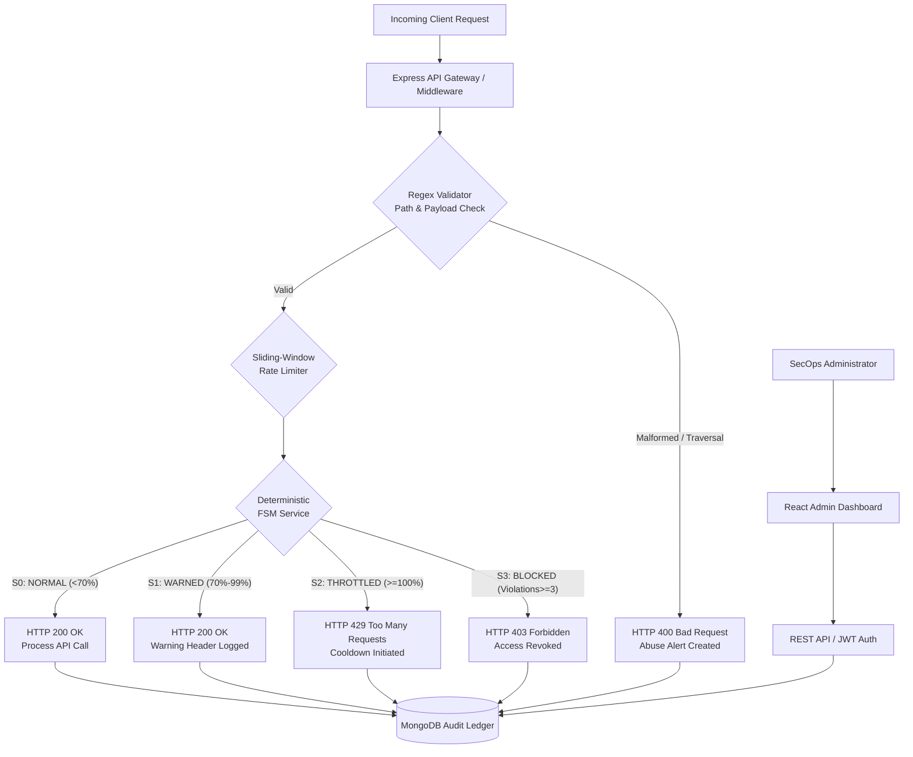
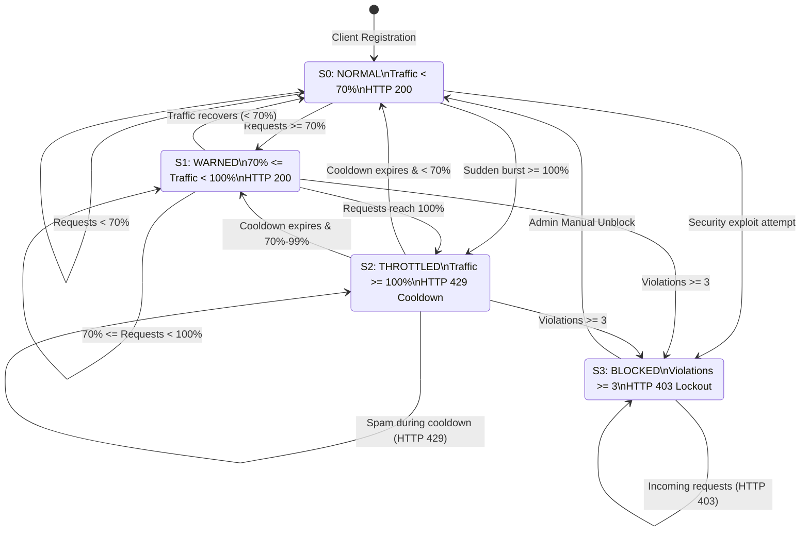

# Rate Limiting and API Abuse Detection System

> A production-grade, full-stack cybersecurity admin platform designed to simulate, intercept, monitor, and regulate API traffic using a deterministic **Finite State Machine (FSM)**, sliding-window rate limiting, and regex security inspection.

---

## 1. Project Overview & Problem Statement

Modern web APIs face persistent threats from botnets, high-frequency scraper bursts, distributed denial-of-service (DDoS) probes, credential-stuffing attacks, and path traversal vectors. Standard static rate limiters often fail to differentiate between accidental surges and persistent malicious abuse.

The **Rate Limiting and API Abuse Detection System** solves this challenge by implementing an intelligent, deterministic **Finite State Machine (FSM)**. Rather than relying on simple boolean permit/deny switches, the engine dynamically transitions client security postures across **NORMAL (S0)**, **WARNED (S1)**, **THROTTLED (S2)**, and **BLOCKED (S3)** states based on sliding-window request volumes, active cooldown adherence, and threat signature detection.

---

## 2. Key Objectives

1. **Deterministic Access Control**: Implement a mathematical 4-state FSM model governing client permissions.
2. **Sliding-Window Rate Limiting**: Compute accurate real-time request rates based on timestamped request records in MongoDB.
3. **Automated Abuse Classification**: Detect rapid bursts, post-throttle violations, path traversal exploits, and malformed payloads, assigning severity tiers (`LOW`, `MEDIUM`, `HIGH`, `CRITICAL`).
4. **Traffic Simulation Hub**: Provide an interactive SecOps simulator allowing single, batch (5, 10, 50), and continuous traffic streams routed through the Express backend.
5. **Modern Cybersecurity UI/UX**: Deliver a dark navy & charcoal command dashboard equipped with interactive Recharts, live activity feeds, and state topology diagrams.

---

## 3. Technology Stack

### Frontend
- **Framework**: React.js 18 (Vite Bundler)
- **Routing**: React Router DOM v6
- **Styling**: Tailwind CSS with custom Cybersecurity Theme
- **Data Visualization**: Recharts (Area charts, Donut charts, Bar charts)
- **Icons**: Lucide React Icons (No emojis)
- **HTTP Client**: Axios with JWT Interceptors

### Backend
- **Runtime**: Node.js & Express.js (RESTful API architecture)
- **State Machine**: Custom Deterministic FSM Engine (`fsmService.js`)
- **Rate Limiting**: Sliding-Window Algorithm (`rateLimiterService.js`)
- **Security & Regex**: Regular Expression Validation Module (`regexValidator.js`)
- **Authentication**: JWT (JSON Web Tokens) with `bcryptjs` password hashing

### Database
- **Engine**: MongoDB & Mongoose ODM
- **Collections**: `admins`, `clients`, `apirequests`, `abusealerts`, `statetransitions`, `systemsettings`

---

## 4. System Architecture



---

## 5. Finite State Machine (FSM) Implementation

The FSM classifies client behavior into 4 distinct states:
- **S0 = NORMAL**: Requests are under 70% of the limit in the current sliding window.
- **S1 = WARNED**: Requests reach or exceed 70% but remain below 100%.
- **S2 = THROTTLED**: Requests reach or exceed 100%. Client enters a temporary cooldown (default: 30s) and calls are rejected with `HTTP 429`.
- **S3 = BLOCKED**: Persistent violations ($\ge 3$) or severe exploit attempts lock the client out with `HTTP 403` until an admin manually unblocks them.

### State Transition Diagram



### State Transition Table

| Current State | Input / Condition | Next State | Action & Status |
|:---|:---|:---|:---|
| **NORMAL (S0)** | Requests $< 70\%$ of limit | **NORMAL (S0)** | `HTTP 200 OK` (Standard access) |
| **NORMAL (S0)** | $70\% \le \text{Requests} < 100\%$ | **WARNED (S1)** | `HTTP 200 OK` (Warning flagged) |
| **NORMAL (S0)** | Requests $\ge 100\%$ of limit | **THROTTLED (S2)** | `HTTP 429 Too Many Requests` (Cooldown 30s) |
| **NORMAL (S0)** | Violations $\ge 3$ or exploit | **BLOCKED (S3)** | `HTTP 403 Forbidden` (Locked out) |
| **WARNED (S1)** | Requests $< 70\%$ (traffic slows) | **NORMAL (S0)** | `HTTP 200 OK` (Warning cleared) |
| **WARNED (S1)** | Requests reach $\ge 100\%$ | **THROTTLED (S2)** | `HTTP 429 Too Many Requests` |
| **WARNED (S1)** | Violations $\ge 3$ | **BLOCKED (S3)** | `HTTP 403 Forbidden` |
| **THROTTLED (S2)** | Request during active cooldown | **THROTTLED (S2)** | `HTTP 429` (Cooldown violation logged) |
| **THROTTLED (S2)** | Cooldown expires & traffic $< 70\%$ | **NORMAL (S0)** | `HTTP 200 OK` (Access restored) |
| **THROTTLED (S2)** | Cooldown expires & traffic $70\%-99\%$ | **WARNED (S1)** | `HTTP 200 OK` (Elevated monitoring) |
| **THROTTLED (S2)** | Persistent abuse / violations $\ge 3$ | **BLOCKED (S3)** | `HTTP 403 Forbidden` |
| **BLOCKED (S3)** | Any incoming request | **BLOCKED (S3)** | `HTTP 403 Forbidden` (Critical alert) |
| **BLOCKED (S3)** | Admin manual unblock | **NORMAL (S0)** | Counters reset; restored to NORMAL |

---

## 6. Regular Expression (Regex) Security Module

Located in `backend/utils/regexValidator.js`:
- **API Endpoint Path**: `^\/[a-zA-Z0-9_.\-\/~%]*$` (Must start with `/`, rejects consecutive slashes `//`, forbids path traversal vectors `\.\.`, `%2e%2e`, `/etc/passwd`).
- **HTTP Methods**: `^(GET|POST|PUT|DELETE)$`.
- **Client ID**: `^(client_)?[a-zA-Z0-9_\-]{4,40}$`.
- **API Key**: `^(sec|key)_[a-zA-Z0-9]{20,64}$`.
- **Payload Sanitization**: Rejects `<script>` tags and JSON syntax anomalies.

---

## 7. Installation & Setup Instructions

### Prerequisites
- **Node.js**: v18+ (Tested on Node v20/v26)
- **MongoDB**: Local MongoDB instance (`mongodb://127.0.0.1:27017`) or MongoDB Atlas URI

### Clone and Install Dependencies
```bash
# Clone the repository
git clone https://github.com/your-username/rate-limit-abuse-detection.git
cd rate-limit-abuse-detection

# Install root, backend, and frontend dependencies
npm install
cd backend && npm install
cd ../frontend && npm install
cd ..
```

### Environment Configuration
Copy `.env.example` to `backend/.env`:
```env
PORT=5000
NODE_ENV=development
MONGODB_URI=mongodb://127.0.0.1:27017/ratelimit_db
JWT_SECRET=cyber_ratelimit_secret_key_super_secure_2026

# Seeded Administrator Credentials
ADMIN_EMAIL=admin@security.local
ADMIN_PASSWORD=Admin@123456
ADMIN_USERNAME=SecOps_Admin
```

### Seed Database
Populate the database with sample clients, requests, threat alerts, and the default admin:
```bash
npm run seed
```

### Run the Application
You can run both backend and frontend concurrently:
```bash
# Terminal 1: Backend API Server (Port 5000)
npm run backend

# Terminal 2: Frontend Vite Development Server (Port 5173)
npm run frontend
```
Or view the compiled production web dashboard directly on `http://localhost:5000`.

---

## 8. Default Administrator Credentials
- **Portal URL**: `http://localhost:5173/login` (or `http://localhost:5000/login`)
- **Email**: `admin@security.local`
- **Password**: `Admin@123456`
*(A convenient "Use Default Seed Admin" one-click button is provided on the login page)*

---

## 9. Verification & Automated Test Scenarios

Run the automated test suite covering all 7 mandatory verification scenarios:
```bash
npm run test
```

### Test Suite Output
```text
===============================================================
   STARTING AUTOMATED VERIFICATION: FSM & RATE LIMIT SUITE     
===============================================================
[TEST 1] Scenario 1: Normal requests (< 70% limit)
  PASS: Client remains in NORMAL state (4/10 requests)

[TEST 2] Scenario 2: Client reaches 70% threshold (WARNED)
  PASS: Transitioned to WARNED state at 70% capacity (7/10)

[TEST 3] Scenario 3: Client reaches request limit (THROTTLED)
  PASS: Transitioned to THROTTLED state with active cooldown

[TEST 4] Scenario 4: Repeated violations exceed threshold (BLOCKED)
  PASS: Client escalated to BLOCKED due to repeated violations

[TEST 5] Scenario 5: Blocked client sends request (HTTP 403 rejection)
  PASS: Blocked client request rejected with HTTP 403 Forbidden

[TEST 6] Scenario 6: Admin manual unblock operation
  PASS: Client unblocked and safely restored to NORMAL state

[TEST 7] Scenario 7: Regex endpoint & traversal validation
  PASS: Regex validation properly permitted clean URL and rejected path traversal & malformed inputs

===============================================================
   TEST RESULTS: 7/7 SCENARIOS PASSED (100%)       
===============================================================
```

---

## 10. Project Directory Structure

```text
rate-limit-abuse-detection/
├── backend/
│   ├── config/
│   │   └── db.js                 # MongoDB connection handler
│   ├── controllers/
│   │   ├── authController.js     # Admin JWT authentication
│   │   ├── clientController.js   # Client CRUD & unblock actions
│   │   ├── requestController.js  # Traffic simulation & audit query
│   │   ├── dashboardController.js# Aggregated chart telemetry
│   │   ├── alertController.js    # Threat alerts & resolution
│   │   ├── fsmController.js      # FSM definitions & history
│   │   └── settingsController.js # Global rate limit policies
│   ├── middleware/
│   │   ├── authMiddleware.js     # JWT Bearer protection
│   │   └── errorHandler.js       # Centralized error handler
│   ├── models/
│   │   ├── Admin.js              # Admin schema with bcrypt
│   │   ├── Client.js             # Client schema & states
│   │   ├── APIRequest.js         # Audit log collection
│   │   ├── AbuseAlert.js         # Threat alerts collection
│   │   ├── StateTransition.js    # FSM state transition logs
│   │   └── SystemSetting.js      # Global system configuration
│   ├── routes/                   # Express REST route handlers
│   ├── services/
│   │   ├── fsmService.js         # Deterministic Finite State Machine
│   │   ├── rateLimiterService.js # Sliding-window rate limiter
│   │   └── abuseDetectionService.js # Abuse pattern detector
│   ├── utils/
│   │   ├── regexValidator.js     # Endpoint & payload regex validation
│   │   └── keyGenerator.js       # Secure Client ID & API key generator
│   ├── seed/
│   │   └── seed.js               # Database seeding script
│   ├── tests/
│   │   └── fsm_ratelimit.test.js # Automated verification test suite
│   ├── .env
│   └── server.js                 # Express server entrypoint
├── frontend/
│   ├── src/
│   │   ├── components/common/    # Reusable Card, StatCard, Badge, Modal
│   │   ├── context/              # AuthContext & ToastContext
│   │   ├── layouts/              # Cyber Sidebar & Header Layout
│   │   ├── pages/
│   │   │   ├── Login.jsx         # SecOps login portal
│   │   │   ├── Dashboard.jsx     # Telemetry KPI cards & Recharts
│   │   │   ├── Clients.jsx       # Client management & quota tracker
│   │   │   ├── Simulator.jsx     # Traffic simulator & live response inspector
│   │   │   ├── Requests.jsx      # Searchable audit ledger
│   │   │   ├── Alerts.jsx        # Threat alerts queue & resolution
│   │   │   ├── FsmVisualization.jsx # Interactive diagram & transition table
│   │   │   └── Settings.jsx      # Global rate limit policies editor
│   │   ├── services/api.js       # Axios client & API endpoints
│   │   ├── App.jsx               # Route definitions & guards
│   │   ├── main.jsx              # React DOM root
│   │   └── index.css             # Tailwind base & cyber animations
│   ├── index.html
│   ├── vite.config.js
│   └── tailwind.config.js
├── docs/
│   ├── STATE_TRANSITION_DIAGRAM.md
│   ├── STATE_TRANSITION_TABLE.md
│   ├── API_DOCUMENTATION.md
│   └── TEST_CASES.md
├── .env.example
├── .gitignore
├── package.json
└── README.md
```

---

## 11. License
This project is open-source under the MIT License.
