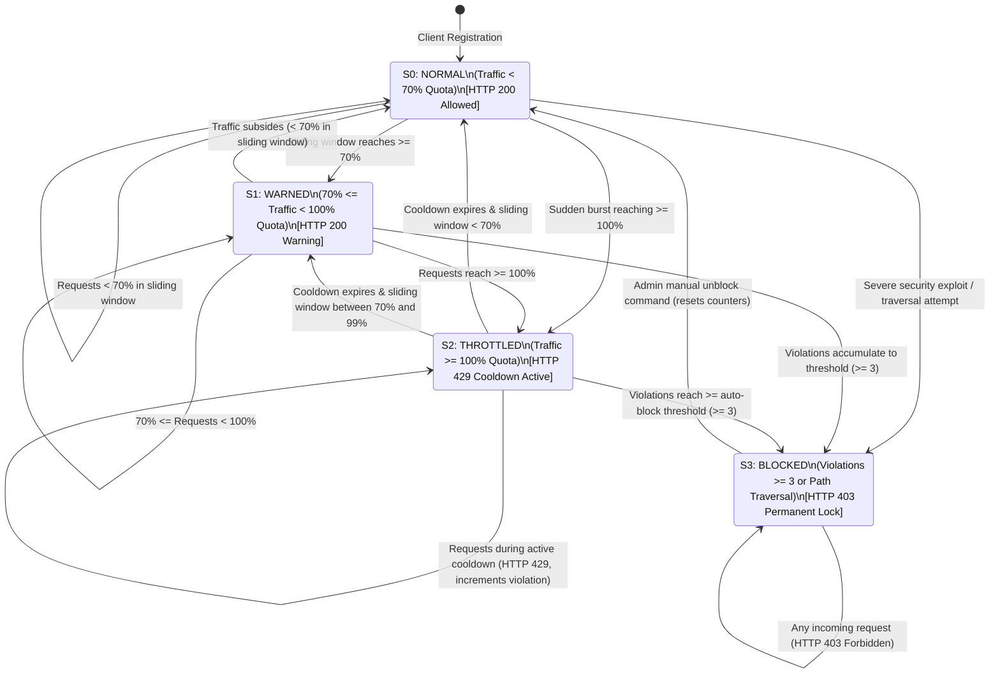

# Finite State Machine (FSM) State Transition Diagram

## System Overview
The **Rate Limiting and API Abuse Detection System** uses a formal, deterministic Finite State Machine (FSM) to classify, monitor, and regulate client access based on real-time traffic telemetry and sliding window request counts.

---

## State Definitions

| State Code | State Name | Operational Description | Default Action |
|:---|:---|:---|:---|
| **S0** | **NORMAL** | Traffic volume is under 70% of the configured sliding window limit. | Request allowed (`HTTP 200 OK`). Baseline security telemetry recorded. |
| **S1** | **WARNED** | Traffic volume is between 70% and 99% of the configured limit. | Request allowed (`HTTP 200 OK`). Warning telemetry logged; client flagged in response. |
| **S2** | **THROTTLED** | Request volume reaches or exceeds 100% of the sliding window quota. | Request rejected (`HTTP 429 Too Many Requests`). Cooldown timer triggered (30s). Violation logged. |
| **S3** | **BLOCKED** | Client has accumulated repeated severe violations ($\ge 3$) or breached security policies. | Request rejected immediately (`HTTP 403 Forbidden`). Permanent lockout until manual admin unblock. |

---

## Mermaid State Transition Diagram

---

## Detailed Mathematical Transition Rules

1. **Rule R1: Normal Stability**
   $$\text{count}(t - W, t) < 0.70 \times L \implies S_{t} = \text{NORMAL}$$
2. **Rule R2: Warning Escalation**
   $$0.70 \times L \le \text{count}(t - W, t) < L \implies S_{t} = \text{WARNED}$$
3. **Rule R3: Throttling Initiation**
   $$\text{count}(t - W, t) \ge L \implies S_{t} = \text{THROTTLED}, \quad \text{CooldownUntil} = t + T_{\text{cooldown}}$$
4. **Rule R4: Automated Lockdown Escalation**
   $$V_{\text{client}} \ge \Theta_{\text{autoblock}} \implies S_{t} = \text{BLOCKED}$$
5. **Rule R5: Cooldown Recovery**
   $$t > \text{CooldownUntil} \land \text{count}(t - W, t) < 0.70 \times L \implies S_{t} = \text{NORMAL}$$
6. **Rule R6: Administrative Restoration**
   $$\text{AdminAction}(\text{Unblock}) \implies S_{t} = \text{NORMAL}, \quad V_{\text{client}} = 0, \quad \text{CooldownUntil} = \text{null}$$
